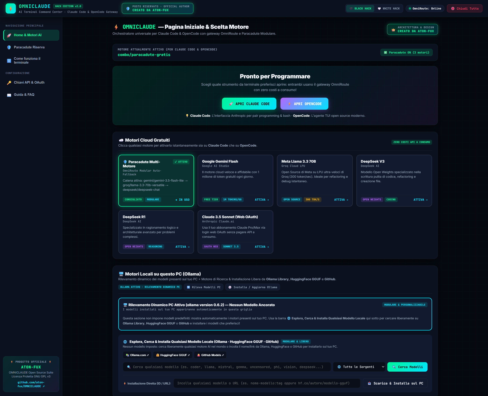
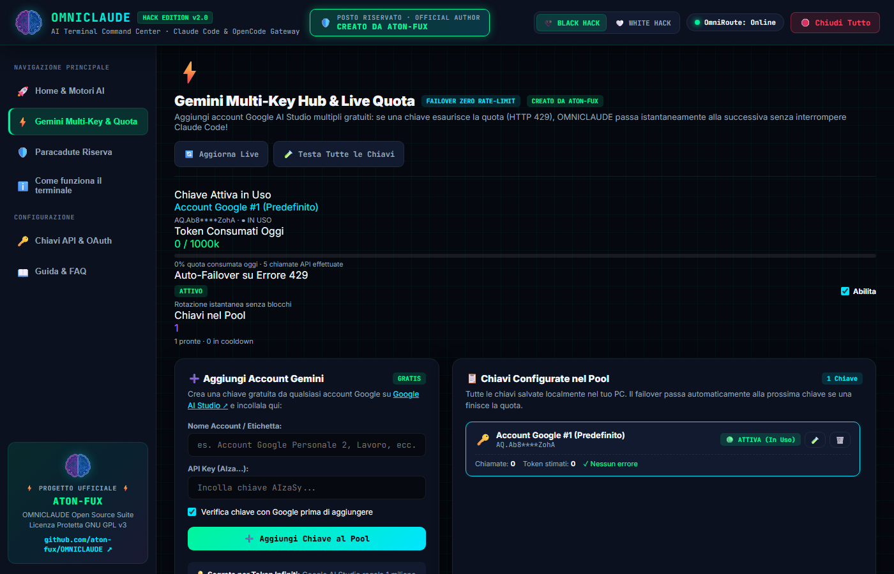
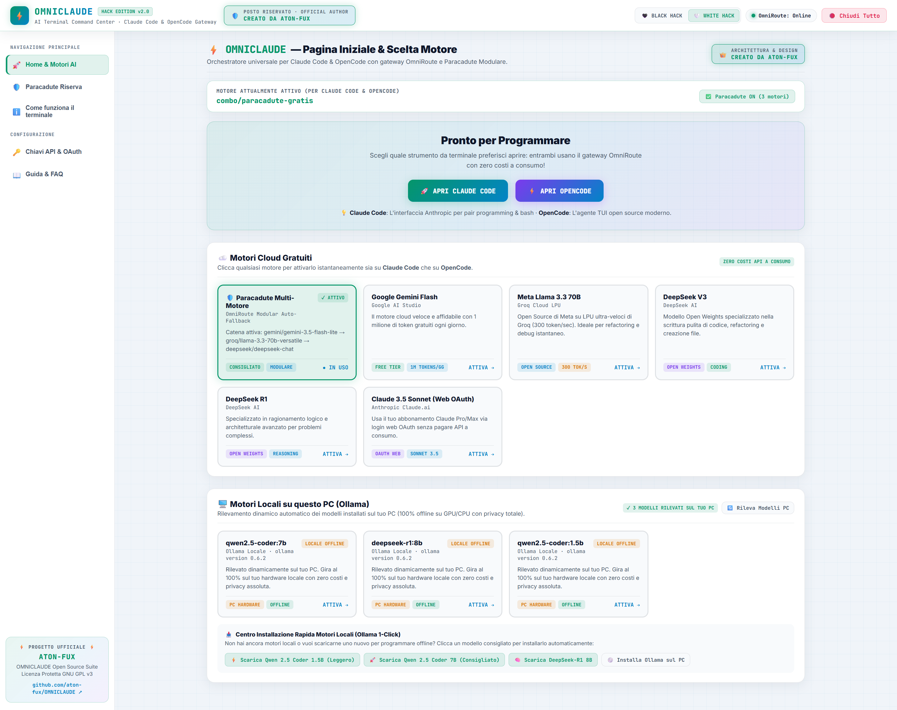
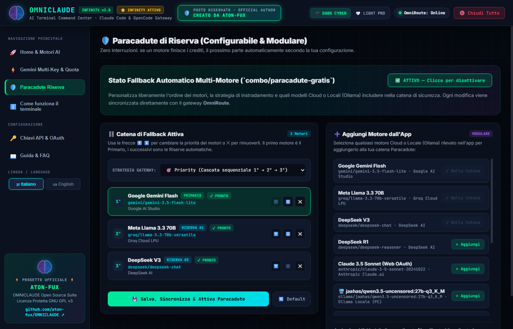

<div align="center">


# ⚡ OMNICLAUDE — Pro Edition v2.0

### **AI Terminal Command Center per Claude Code & OpenCode con Gateway OmniRoute & Paracadute Modulare**

**Ideato, Progettato e Creato da [ATON-FUX](https://github.com/aton-fux)**

[](https://github.com/aton-fux)
[](https://github.com/aton-fux/OMNICLAUDE)
[-b366ff?style=for-the-badge)](./LICENSE)
[](#installazione-rapida)
[](#architettura-e-concetto-del-tool)

---

### 🖼️ Anteprima Ufficiale ad Alta Risoluzione — Pagina Iniziale (`DARK CYBER THEME`)



</div>

---

## 🎯 Concetto, Scopo e Funzioni di OMNICLAUDE

**OMNICLAUDE** (creato da **ATON-FUX**) è una suite di comando web leggera, portatile e a **zero dipendenze esterne** che permette di utilizzare i due migliori agenti di programmazione da terminale — **Claude Code** (di Anthropic) e **OpenCode** (TUI open-source) — collegandoli istantaneamente a **motori AI Cloud gratuiti** (Google Gemini Flash, Groq Llama 3.3 70B, DeepSeek V3/R1, OpenRouter), al proprio **account web Claude.ai (OAuth)** oppure a **modelli 100% Locali e Offline su GPU/CPU tramite Ollama**.

### ✨ Punti di Forza Esclusivi della v2.0 (Pro Edition by ATON-FUX)

1. **🎨 Stile & Tema Cyber Moderno (`🖤 DARK CYBER` / `🤍 LIGHT PRO`)**  
   Interfaccia cyber-moderna ad alto contrasto con selettore istantaneo tra modalità **Dark Cyber** (nero ossidiana e verde/ciano neon) e **Light Pro** (bianco cyber-lab nitido), con salvataggio automatico delle preferenze.
2. **🏠 Pagina Iniziale All-In-One Intelligente**  
   Sotto al box di lancio rapido **Pronto per Programmare** (`🚀 APRI CLAUDE CODE` e `⚡ APRI OPENCODE`), trovi direttamente le griglie complete e interattive di:
   - **☁️ Motori Cloud Gratuiti** (attivabili con 1 solo clic).
   - **🖥️ Motori Locali su questo PC (Ollama)** (rilevati automaticamente in tempo reale dal tuo hardware).
3. **⚡ Gemini Multi-Key Hub & Live Quota Rotator (Zero Rate-Limit · OMNICLAUDE PRO)**  
   Google Gemini offre 1 milione di token al giorno per account gratis, ma nei task intensivi di pair programming si può incappare nel limite giornaliero o al minuto (HTTP 429). Con il **Gemini Multi-Key Hub** (disponibile con licenza **OMNICLAUDE PRO a 14,99€ Una Tantum**):
   - Aggiungi quante chiavi vuoi da diversi account Google con etichetta personalizzata;
   - Monitora in tempo reale con barra dinamica i **token consumati oggi** rispetto al milione gratuito;
   - **Failover Automatico in millisecondi**: se la chiave attiva esaurisce i token o va in 429, OMNICLAUDE passa istantaneamente alla chiave successiva in standby senza interrompere Claude Code o OpenCode!
   - Test live delle chiavi direttamente contro le API Google e auto-ripristino al termine del cooldown.
   *(La versione Community gratuita consente 1 chiave Gemini; per sbloccare account illimitati e rotazione continua a caldo visita la 👉 [Vetrina Ufficiale OMNICLAUDE PRO](https://aton-fux.github.io/omniclaude-store/) oppure [Acquista la Licenza a 14,99€](https://atonfux.gumroad.com/l/omniclaude-pro))*.
4. **🛡️ Paracadute di Riserva 100% Configurabile e Modulare**  
   Se un motore esaurisce i crediti o raggiunge il limite di richieste durante una sessione di programmazione, **OMNICLAUDE** passa automaticamente al motore successivo senza interrompere il lavoro. Dalla sezione **Paracadute Riserva** puoi:
   - Riordinare la priorità dei motori con le frecce **⬆️ / ⬇️**;
   - Aggiungere o rimuovere qualsiasi motore **Cloud** o **Locale (Ollama)** presente nell'app;
   - Scegliere la strategia di instradamento (`Priority` a cascata, `Round-Robin`, `Least-Used`).
5. **ℹ️ Guida Rapida Terminale Integrata nel Pannello Sinistro**  
   Un pulsante dedicato nel menu laterale (`ℹ️ Come funziona il terminale`) raccoglie tutte le istruzioni operative e le scorciatoie essenziali, mantenendo la Home pulita e focalizzata sui motori.
6. **🛑 Chiusura Totale e Pulizia Memoria RAM / VRAM (`100% Clean`)**  
   Con un clic su **`🛑 Chiudi Tutto`** (o tramite `FERMA.bat`), il sistema chiude i processi `claude.exe` e `opencode.exe`, scarica i modelli locali Ollama dalla scheda video (**liberando il 100% della VRAM GPU**) e arresta gateway e server web.

---

## 🖼️ Galleria Interfaccia (Gemini Multi-Key Hub, Light Pro & Paracadute Modulare)

### ⚡ Gemini Multi-Key Hub & Live Quota Rotator (`ZERO RATE-LIMIT`)


### 🤍 Modalità `LIGHT PRO` (Tema Chiaro ad Alto Contrasto)


### 🛡️ Configuratore Modulare del Paracadute di Riserva


---

## 🚀 Installazione Rapida

Puoi scaricare e installare **OMNICLAUDE** in meno di 60 secondi su qualsiasi PC Windows 10/11.

### Metodo 1: Clonazione con Git (Consigliato)

Apri il terminale (`PowerShell` o `CMD`) ed esegui:

```powershell
git clone https://github.com/aton-fux/OMNICLAUDE.git
cd OMNICLAUDE
.\INSTALLA.bat
```

### Metodo 2: Download Diretto (ZIP Portatile)

1. Scarica il pacchetto ufficiale cliccando qui:  
   👉 **[📥 Scarica OMNICLAUDE (ZIP Ufficiale da GitHub)](https://github.com/aton-fux/OMNICLAUDE/archive/refs/heads/main.zip)**
2. Estrai la cartella sul tuo PC (es. in `Documenti\OMNICLAUDE`).
3. Fai doppio clic su **`INSTALLA.bat`**: lo script verificherà e installerà automaticamente `Node.js`, `OmniRoute`, `Claude Code`, `OpenCode` e configurerà il **Paracadute Modulare** mostrando lo stato `[PASSED]`.
4. Fai doppio clic su **`START.bat`** per aprire il Command Center nel browser (`http://localhost:3000`)!

---

## 🗂️ Struttura dei File del Progetto

| File / Cartella | Funzione Principale |
|---|---|
| **`START.bat`** | 🟢 **Avvio Principale:** avvia il gateway OmniRoute in background, lancia il server web locale e apre la dashboard **OMNICLAUDE** su `http://localhost:3000`. |
| **`START_CLAUDE.bat`** | 🚀 **Claude Code Diretto:** apre direttamente il terminale interattivo di Claude Code agganciato al motore attivo in OMNICLAUDE. |
| **`START_OPENCODE.bat`** | ⚡ **OpenCode Diretto:** apre direttamente l'interfaccia TUI di OpenCode agganciata al motore attivo in OMNICLAUDE. |
| **`FERMA.bat`** | 🔴 **Arresto Totale & Pulizia RAM/VRAM:** termina tutti i processi, scarica i modelli dalla scheda grafica (VRAM) e libera le porte `3000` e `20128`. |
| **`INSTALLA.bat`** | ⚙️ **Installatore & Diagnostica:** installa e configura in automatico tutte le dipendenze necessarie su un nuovo PC. |
| **`LOGIN_CLAUDE.bat`** | 🌐 **Login OAuth Claude Web:** collega il tuo account Claude.ai (Pro/Max) tramite browser senza usare chiavi API a consumo. |
| **`server.py`** | 🧠 **Backend OMNICLAUDE:** server HTTP multithread scritto in Python puro (zero dipendenze esterne) per la gestione di modelli, chiavi, failover automatico Gemini, Paracadute modulare e processi. |
| **`web/index.html`** | 💻 **Frontend Pro Edition v2.0:** interfaccia web reattiva con selettore Dark Cyber / Light Pro, Gemini Multi-Key Hub, selezione motori in Home e configuratore Paracadute. |
| **`gemini_keys.json`** | 🔐 **Pool Multi-Key Gemini Locale:** archiviazione sicura locale delle API key di Google Gemini e stato quota (protetto da `.gitignore`). |
| **`config.example.env`** | 🔐 **Template Configurazione:** modello pulito per il file `config.env` locale (le tue chiavi personali restano solo sul tuo PC grazie a `.gitignore`). |

---

## 🛠️ Guida Completa all'Utilizzo

### 1️⃣ Avviare Claude Code o OpenCode dalla Pagina Iniziale
1. Fai doppio clic su **`START.bat`**.
2. Nella **Pagina Iniziale** di OMNICLAUDE (`http://localhost:3000`), scorri nello spazio sotto a **Pronto per Programmare** e clicca sul motore che preferisci tra **☁️ Motori Cloud Gratuiti** o **🖥️ Motori Locali su questo PC (Ollama)**.
3. Clicca su **`🚀 APRI CLAUDE CODE`** oppure su **`⚡ APRI OPENCODE`**.
4. Si aprirà la finestra del terminale pronta per programmare!

### 2️⃣ Configurare il Paracadute di Riserva Modulare
1. Nel pannello sinistro clicca su **`🛡️ Paracadute Riserva`**.
2. Nella colonna di sinistra (**Catena di Fallback Attiva**) puoi:
   - Spostare i motori in alto (**⬆️**) o in basso (**⬇️**) per decidere l'ordine di intervento;
   - Rimuovere un motore (**✕**);
   - Scegliere la strategia del gateway (`Priority`, `Round-Robin`, `Least-Used`).
3. Nella colonna di destra (**➕ Aggiungi Motore dall'App**) puoi aggiungere con un clic qualsiasi motore Cloud o qualsiasi modello locale **Ollama** installato sul tuo PC, oppure inserire un ID modello personalizzato (es. da OpenRouter).
4. Clicca su **`💾 Salva, Sincronizza & Attiva Paracadute`**.

### 3️⃣ Motore di Ricerca & Installazione Libera Modelli Locali (Ollama · HuggingFace GGUF · GitHub)
OMNICLAUDE **non impone né ancora modelli locali fissi**:
1. Nella sezione **🖥️ Motori Locali su questo PC (Ollama)** della Pagina Iniziale, il sistema rileva dinamicamente solo i modelli effettivamente installati sul tuo PC (con possibilità di attivarli o disinstallarli `🗑️`).
2. Tramite l'**Hub Modulare di Ricerca Multi-Sorgente** integrato puoi:
   - Cercare in tempo reale qualsiasi modello su **📚 Ollama Library**, **🤗 HuggingFace Hub (GGUF Direct Pull)** e **🐙 GitHub Repositories**;
   - Scegliere la variante/taglia di parametri adatta alla tua scheda video (es. `:1.5b`, `:7b`, `:14b`, `:32b`, `:latest`) e installarla in 1 click;
   - Incollare qualsiasi ID o URL diretto (`nome:tag` oppure `hf.co/autore/modello-gguf`) per scaricarlo e usarlo subito offline con Claude Code e OpenCode.

### 4️⃣ ⚡ Gemini Multi-Key Hub & Rotazione Automatica (Zero Rate-Limit)
Google Gemini offre 1 milione di token al giorno per account gratis, ma programmando intensamente si possono raggiungere i limiti di rate limit (HTTP 429). Con il **Gemini Multi-Key Hub**:
1. Clicca su **`⚡ Gemini Multi-Key & Quota`** nel menu sinistro (o dal banner in Home).
2. **Aggiungi quante chiavi vuoi** generate da account Google distinti (es. `Account Personale`, `Account Secondario`, `Account Dev`).
3. Il sistema verifica istantaneamente la chiave tramite ping alle API ufficiali di Google.
4. **Monitoraggio Quota Live:** visualizza i token consumati nella giornata rispetto al tetto di 1.000.000 token, con barra dinamica di riempimento.
5. **Zero Rate-Limit Auto-Failover:** quando la chiave attiva raggiunge il rate limit (429) o esaurisce la quota, il daemon di OMNICLAUDE passa automaticamente in tempo reale alla chiave successiva disponibile senza che tu debba riavviare o perdere il contesto nel terminale! Al termine della finestra di rate limit, la chiave torna verde e riutilizzabile.

### 5️⃣ Dove Ottenere le Chiavi API Gratuite
Non serve inserire decine di chiavi: **te ne basta una sola** per iniziare!
- **Google Gemini Flash (Consigliato — 1M token/giorno gratis):** ottieni la chiave gratuita in 20 secondi su [aistudio.google.com/app/apikey](https://aistudio.google.com/app/apikey).
- **Groq Cloud (Llama 3.3 70B — 300 token/sec gratis):** ottieni la chiave gratuita su [console.groq.com/keys](https://console.groq.com/keys).
- **DeepSeek (V3 & R1):** disponibile su [platform.deepseek.com/api_keys](https://platform.deepseek.com/api_keys).
- **OpenRouter (Modelli `:free`):** disponibile su [openrouter.ai/keys](https://openrouter.ai/keys).

Inserisci le chiavi direttamente dalla sezione **`🔑 Chiavi API & OAuth`** dell'interfaccia web!

---

## 👑 Autore, Riconoscimenti e Licenza Ufficiale

<div align="center">

### **Progetto Ideato, Sviluppato e Mantenuto da [ATON-FUX](https://github.com/aton-fux)**

</div>

### 📜 Licenza del Progetto (`GNU GPL v3.0` + Clausole Sezione 7)
Questo progetto e tutte le relative modifiche, l'architettura web **OMNICLAUDE**, il sistema di **Paracadute Modulare** e gli script di automazione sono rilasciati sotto licenza **[GNU General Public License v3.0 (GPL-3.0)](./LICENSE)** con termini aggiuntivi ai sensi della **Sezione 7 GPLv3**:

- **Obbligo di Riconoscimento (`ATON-FUX`):** chiunque utilizzi, copi, distribuisca o modifichi questo codice deve mantenere visibile l'attribuzione ufficiale **"Creato da ATON-FUX"** nell'interfaccia e nella documentazione.
- **Tracciabilità delle Modifiche:** qualsiasi modifica effettuata da terzi deve essere dichiarata chiaramente, senza rimuovere i crediti originali di **ATON-FUX**.
- **Protezione Copyleft e Brevetti:** nessuno può chiudere o privatizzare questo codice; ogni versione derivata deve rimanere open-source sotto la medesima licenza GPL-3.0, con esonero totale di responsabilità per l'autore originale.

### ⚖️ Tutela Legale e Conformità con Licenze di Terze Parti
Per la massima trasparenza e conformità legale (vedi file completo **[NOTICE.md](./NOTICE.md)**):
- **OMNICLAUDE** distribuisce esclusivamente codice sorgente originale di orchestrazione, configurazione e interfaccia web scritto da **ATON-FUX**.
- **Nessun binario proprietario viene ridistribuito:** strumenti di terze parti quali *Claude Code* (marchio di Anthropic, PBC), *OpenCode*, *OmniRoute* e *Ollama* vengono installati autonomamente dall'utente finale dai rispettivi canali ufficiali (`npm` / `winget`) nel pieno rispetto delle rispettive licenze e termini d'uso.
- Nessuna chiave API privata è inclusa nel repository pubblico.
